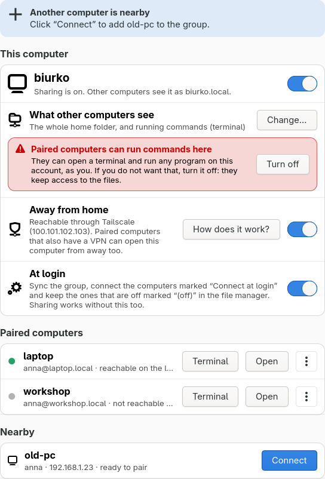
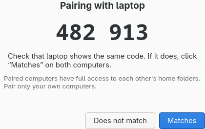
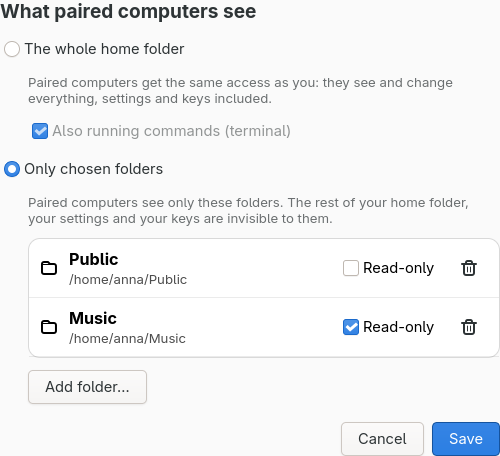
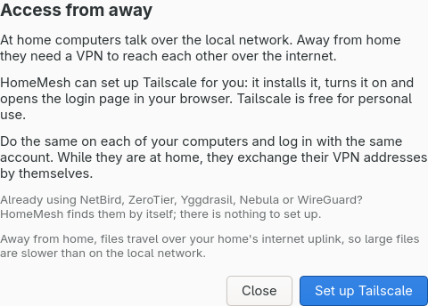

# HomeMesh

**English** · [Polski](README.pl.md)

The home folders of all your computers, right in your file manager. Pair two
computers once with a six-digit code, like Bluetooth devices, and each one
shows up in the sidebar of Nautilus, Dolphin, Thunar, Nemo or Caja: click it
and you are browsing, copying and editing files on the other computer. At
home over the local network; away from home through a VPN, if you have one.

No Samba, no NFS, no server to run: underneath is plain SSH/SFTP, which every
Linux computer already has.

<picture>
  <source media="(prefers-color-scheme: dark)" srcset="docs/screenshots/en/overview-dark.png">
  
</picture>

## At a glance

| | |
|---|---|
| **Three clicks** | *Turn on* sharing, open HomeMesh on the other computer, click *Connect* and check that both screens show the same code. A bar at the top of the window always says what to do next and offers a fix when something is wrong. |
| **Paired like Bluetooth** | Computers swap SSH keys and compare a six-digit code. If the codes match, nobody on the network tampered with the exchange. No passwords, no typing addresses. |
| **Introductions** | Pair a new computer with any member of the group and it gets to know all of them; members it never met learn about it the next time they talk. Removing a computer spreads the same way. |
| **Your file manager** | Paired computers appear as bookmarks in GTK file managers (GVfs) and in Dolphin (KIO). A click mounts; optionally they mount at login. A computer that is off is marked: *(off) laptop*. |
| **Choose what to share** | The whole home folder, or only chosen folders, each read-write or read-only. Chosen folders are served from a sandbox: the rest of your home, your keys and the system are simply not there. |
| **A terminal on the other computer** | *Terminal* next to *Open* logs in to that computer in your own terminal program, at home or through the VPN. On by default with the whole home folder, under a red warning with *Turn off* right in the window. |
| **Away from home** | One click sets up Tailscale: HomeMesh installs it, starts it and opens the login page; no commands. Already have NetBird, ZeroTier, Yggdrasil, Nebula or WireGuard? It finds them by itself. Each connection goes over the local network when possible and through the VPN otherwise, with the same bookmarks. |
| **Copes with a shaky network** | Where the local network keeps losing the way between two computers (a Wi-Fi mesh that is slow to notice that a laptop moved, for example), connections go through the VPN first until it has been quiet for three days: about as fast at home, and open folders stay open. The window says so and [what helps](docs/local-network.md). |
| **Light** | GTK 4 without libadwaita, so it fits any desktop. No system daemon: sharing is the system's `sshd`; the window is needed only to find and pair computers, and one small process in your session marks the ones that are off. Works with or without systemd. |
| **Terminal too** | Everything the window does, `homemesh` does in a terminal, so headless machines can join. |

## Screenshots

<table>
<tr>
<td width="50%" valign="top">

**Pairing**: both computers show the same code.

<picture>
  <source media="(prefers-color-scheme: dark)" srcset="docs/screenshots/en/pair-dark.png">
  
</picture>

**What other computers see**: everything, or chosen folders.

<picture>
  <source media="(prefers-color-scheme: dark)" srcset="docs/screenshots/en/share-dark.png">
  
</picture>

</td>
<td width="50%" valign="top">

**Away from home**: Tailscale set up with one click.

<picture>
  <source media="(prefers-color-scheme: dark)" srcset="docs/screenshots/en/away-dark.png">
  
</picture>

</td>
</tr>
</table>

The interface speaks English and Polish; [translations](#translations) are welcome.

## Install

From the AUR, the latest release or the development version:

    paru -S homemesh          # or: yay -S homemesh
    paru -S homemesh-git

From a checkout:

    packaging/arch/build-local.sh
    sudo pacman -U build/arch/homemesh-*.pkg.tar.zst

Needs `openssh`, `python-gobject`, `gtk4` and `polkit`. Optional: `gvfs` for
GTK file managers, `kio-extras` for Dolphin, `bubblewrap` for sharing only
chosen folders, `avahi` and `nss-mdns` for `name.local` addresses on systems
without systemd-resolved. When something is missing, HomeMesh shows *Install
missing packages* and installs it with your distribution's package manager
(pacman, apt, dnf, zypper, xbps or apk); in a terminal it asks first, or
`homemesh enable --install`.

## Quick start

1. Open **HomeMesh** and click **Turn on**. The computer asks for the
   administrator password once.
2. Do the same on another computer on the same network. It appears under
   *Nearby*.
3. Click **Connect** and check that both screens show the same code; confirm
   on both.

The other computer is now in your file manager's sidebar. To add a third
computer, pair it with either of the two.

## Away from home

At home computers talk over the local network. Away from home they need a VPN
to find each other over the internet: two computers behind home routers
cannot connect without a helper with a public address, and the existing VPNs
do that job well. HomeMesh does not ship its own; it detects Tailscale,
NetBird, ZeroTier, Yggdrasil, Nebula and WireGuard on its own.

The simplest is Tailscale (free for personal use), and HomeMesh sets it up
for you: turn on the switch in *Away from home*, then click **Set up
Tailscale**.
After the administrator password it:
- installs Tailscale with the system's package manager (pacman, apt, dnf,
  zypper, xbps or apk) or, if the distribution has no package, Tailscale's
  own static build from pkgs.tailscale.com, checked against its sha256;
- starts `tailscaled` at boot with systemd, OpenRC, runit, s6 or dinit,
  writing the service definition itself when the package has none for that
  init system (Artix, for example);
- makes you Tailscale's operator, so the login and later changes need no
  password;
- opens the login page in your browser and carries on once you have logged in.

Do the same on every computer, with the same account (`homemesh away` does it
in a terminal). While the computers are at home they exchange their VPN
addresses; one whose VPN is off for the moment keeps its address, and another
address reaches the others by itself. From then on every connection first checks
the local network (about 40 ms at home; away from home the check gives up
after about a second) and uses the VPN only when the other computer is not
there. Away from home, files travel over your home's internet
uplink, so large files are slower than at home.

The same switch turns Tailscale off on this computer (`homemesh away off`).
Paired computers then reach it only on the local network, and its VPN address
leaves its card at once instead of being kept for a VPN that is off for the
moment. Tailscale stays installed and logged in, so turning it back on takes
a second and no login. A VPN you run by hand stays on: turn it off where you
set it up.

The VPN also helps at home where the [local network keeps
breaking](docs/local-network.md): after the second break in three days SSH
tries the VPN first.

## What other computers see

- **The whole home folder** (default): the same access as your own account,
  settings and keys included. Pair only your own computers.
  - **Also running commands (terminal)**, on by default: paired computers can
    open a terminal here (the *Terminal* button on their side) and run any
    program, as you. The main window says so in red, with *Turn off* next to
    it. Off, they get files only: SFTP and group syncing go through
    `homemesh gate`, everything else is refused. That stops casual use, not a
    determined one, as write access to `~/.bashrc` or autostart is enough to
    plant a command; for a real limit, share chosen folders.
- **Only chosen folders**, each read-write or read-only. Paired computers then
  get SFTP only, served by `sftp-server` inside a [bubblewrap](https://github.com/containers/bubblewrap)
  sandbox that holds an otherwise empty home folder with just those folders.
  There is no shell, no port forwarding, no `~/.ssh`, no `/etc` beyond a
  one-line `passwd`. A change ends running sessions, so it applies at once.

Port, agent and X11 forwarding are off for paired keys in every mode
(`restrict` in `authorized_keys`).

The *Terminal* button runs `ssh` with HomeMesh's own configuration in
`xdg-terminal-exec` when it is installed, otherwise in the terminal set in
Plasma, `$TERMINAL`, the desktop's own terminal or a common one (Ptyxis, GNOME
Console, Konsole, xfce4-terminal, kitty, foot, Alacritty, xterm…). It shows
only for computers that allow it; their card says so.

## Command line

    homemesh                 # the window (on a desktop)
    homemesh status          # this computer and the group
    homemesh enable          # turn sharing on (asks for the admin password)
    homemesh disable         # turn it off, restoring the previous settings
    homemesh pair            # pick a computer nearby and pair with a code
    homemesh pair --wait     # wait for another computer to pair with this one
    homemesh pair NAME|ADDRESS[:PORT]
    homemesh remove NAME     # remove a computer from the group
    homemesh sync            # catch up with the group now
    homemesh share           # what other computers see
    homemesh share add ~/Public [--readonly]
    homemesh share remove ~/Public
    homemesh share home      # back to the whole home folder
    homemesh share terminal on|off   # may paired computers run commands here
    homemesh autostart on|off
    homemesh rename NAME     # rename this computer on the network
    homemesh away            # set up Tailscale for access from away
    homemesh away off        # turn Tailscale off again
    homemesh reset           # leave the group and remove HomeMesh's settings

## How it works

**Turning sharing on** runs a small root helper (`/usr/lib/homemesh/homemesh-helper`)
through polkit, or `sudo` in a terminal. It:
- makes `sshd` accept key logins only (`/etc/ssh/sshd_config.d/10-homemesh.conf`);
- starts it at boot, with systemd, OpenRC, runit, s6 or dinit;
- opens the firewall (ufw or firewalld) for the local network: 22/tcp,
  41753/udp and 41753–41762/tcp; and SSH on the VPN interfaces;
- turns on mDNS if `name.local` does not work yet, in systemd-resolved
  (`/etc/systemd/resolved.conf.d/zz-homemesh-mdns.conf`; being last, it also
  overrides a `MulticastDNS=no` set there before) or else with Avahi.

*Turn off* puts back what was there before. Setting up Tailscale goes through
the same helper (see [Away from home](#away-from-home)); turning sharing off
leaves Tailscale alone.

**Finding computers**: while the window is open, HomeMesh announces itself on
the local network over UDP broadcast. This works without Avahi. Broadcasting
stops once the window is closed.

**Pairing** swaps SSH keys over TCP. The code is computed from everything
swapped, and the answering side first commits to its random number and reveals
it only afterwards. This is the numeric comparison scheme of Bluetooth: someone
in the middle has one chance in a million of producing matching codes.

**Files**: each side writes
- the other's key into `~/.ssh/authorized_keys`, valid only from private
  addresses and from that computer's own VPN addresses;
- its host key into `~/.config/homemesh/known_hosts`, so there is never an
  "are you sure you trust this host" question;
- an entry into `~/.config/homemesh/ssh_config`, included at the top of
  `~/.ssh/config`;
- bookmarks for GTK (`~/.config/gtk-3.0/bookmarks`) and KDE
  (`~/.local/share/user-places.xbel`).

HomeMesh logs in with a key of its own (`~/.config/homemesh/id_ed25519`). It
never touches your keys or any line it did not write.

**The group**: every computer has a card (name, user, home folder, keys, VPN
addresses). Whenever members talk (window open, login, pairing, another VPN
address), they swap what they know through `ssh … homemesh sync-serve`. The
newer card wins, and removals leave a dated tombstone so they spread too. VPN
addresses stay on the card while the VPN is down (Tailscale connects a moment
after login), until it has been down for half a year or is turned off in
HomeMesh.

**At login**: a short task (XDG autostart, can be turned off) catches up with
the group and mounts the computers marked *Connect at login*, then exits.

**Computers that are off**: the same setting starts `homemesh watch`, one
process of about 15 MB that ends with the desktop session. It puts *(off)* in
front of a bookmark's name, where no file manager cuts it off, and takes it
away again; names you gave the bookmarks stay. A computer that is on is asked
once a minute with a single UDP packet to its own address (41753/udp); nothing
is broadcast, and nothing is logged by its `sshd`. One that is off is looked up
every five minutes, but is noticed at once when it starts, because it asks the
others. Only paired computers get answers. Computers with HomeMesh older than
0.5, or with nobody logged in, are checked with an SSH connection every three
minutes instead. The same packets show when the local network between two
computers [keeps breaking](docs/local-network.md); the two tell each other.

## Security

- With the whole home folder shared, paired computers trust each other
  completely: write access to a home folder is as good as running programs
  there, and with the terminal on (the default) they run them directly.
  Pair only your own computers, or share chosen folders.
- No forwarding of ports, the SSH agent or X11 for paired keys.
- Keys work only from private addresses and from the peer's own VPN addresses.
  `sshd` stops accepting passwords over the network.
- Pairing and discovery only accept the local network (and Tailscale/NetBird
  addresses for pairing by address from a terminal).

## Status

Version 0.8: young. It has been tried between Arch-based computers with GNOME,
KDE Plasma and LXQt. Marking the computers that are off has been tried with
pcmanfm-qt; Dolphin's side, installing packages outside Arch and the systems
without systemd (OpenRC, runit, s6, dinit) are written but not yet tested for
real. Reports are welcome.

## Uninstall

    homemesh reset && homemesh disable
    sudo pacman -R homemesh      # or homemesh-git

## Development

    make test                            # 158 tests, before a release; the integration tests run private sshd instances
    packaging/arch/build-local.sh        # package the working tree
    homemesh --demo --screenshot x.png   # render the window with made-up computers

Building the package runs only the quick tests (`HOMEMESH_QUICK_TESTS=1`,
a few seconds): no sshd instances, no real pairing, nothing on the network.

## Translations

Messages are in English in the code and translated with gettext; Polish is
in `po/pl.po`. To add a language: `make pot`, copy `po/homemesh.pot` to
`po/<language>.po`, translate it (keep the `{fields}`), then `make mo` and
run with `LANGUAGE=<language> bin/homemesh`. `make test` checks that every
message is translated and keeps its fields.

## Writing about HomeMesh

Ready-made descriptions in English and Polish, from one line to a full
feature list, are in [docs/descriptions.md](docs/descriptions.md); screenshots are in
[docs/screenshots](docs/screenshots).

## License

MIT
