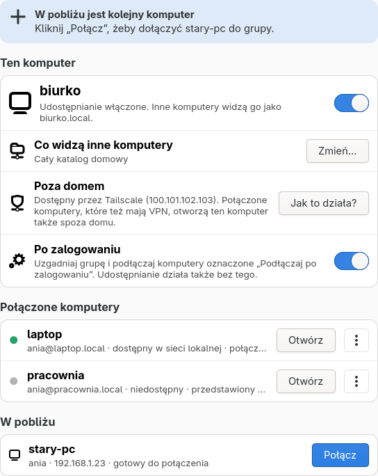
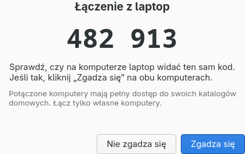
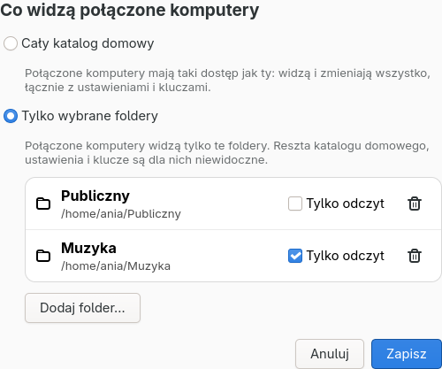
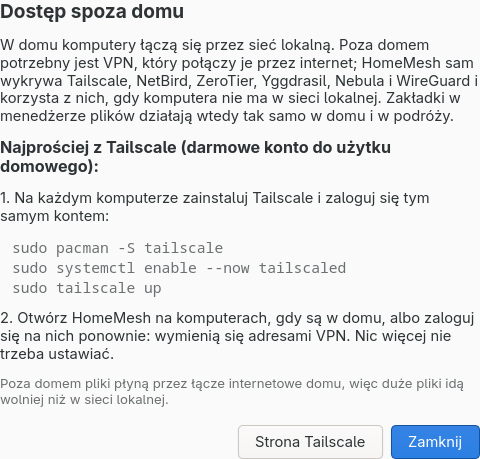

# HomeMesh

[English](README.md) · **Polski**

Katalogi domowe wszystkich twoich komputerów, prosto w menedżerze plików.
Połącz dwa komputery raz, sześciocyfrowym kodem, jak urządzenia Bluetooth, a
każdy pojawi się w panelu bocznym Nautilusa, Dolphina, Thunara, Nemo albo
Caja. Klikasz i przeglądasz, kopiujesz i edytujesz pliki na drugim komputerze.
W domu przez sieć lokalną, poza domem przez VPN, jeśli go masz.

Bez Samby, bez NFS, bez serwera do utrzymania: pod spodem działa zwykłe
SSH/SFTP, które ma każdy Linux.

<picture>
  <source media="(prefers-color-scheme: dark)" srcset="docs/screenshots/overview-dark.png">
  
</picture>

## W skrócie

| | |
|---|---|
| **Trzy kliknięcia** | *Włącz* udostępnianie, otwórz HomeMesh na drugim komputerze, kliknij *Połącz* i sprawdź, czy oba ekrany pokazują ten sam kod. Pasek u góry okna zawsze podpowiada następny krok, a gdy coś jest nie tak, proponuje naprawę. |
| **Parowanie jak Bluetooth** | Komputery wymieniają klucze SSH i porównują sześciocyfrowy kod. Zgodne kody oznaczają, że nikt w sieci nie podmienił danych. Bez haseł, bez wpisywania adresów. |
| **Przedstawianie** | Nowy komputer wystarczy połączyć z dowolnym członkiem grupy, a pozna wszystkich; ci, których nie spotkał, dowiedzą się o nim przy najbliższym kontakcie. Usunięcie komputera rozchodzi się tak samo. |
| **Twój menedżer plików** | Połączone komputery są zakładkami w menedżerach GTK (GVfs) i w Dolphinie (KIO). Kliknięcie montuje; opcjonalnie montują się po zalogowaniu. |
| **Wybierasz, co udostępniasz** | Cały katalog domowy albo tylko wybrane foldery, każdy do odczytu i zapisu albo tylko do odczytu. Wybrane foldery idą z piaskownicy: reszty katalogu domowego, kluczy i systemu po prostu tam nie ma. |
| **Poza domem** | Działa z VPN-em, którego już używasz albo który zainstalujesz: Tailscale, NetBird, ZeroTier, Yggdrasil, Nebula, WireGuard. Połączenie idzie przez sieć lokalną, gdy się da, a w przeciwnym razie przez VPN; zakładki zostają te same. |
| **Lekki** | GTK 4 bez libadwaita, więc pasuje do każdego pulpitu. Bez demona: pliki podaje systemowy `sshd`, a okno jest potrzebne tylko do znajdowania i łączenia komputerów. Działa z systemd i bez niego. |
| **Także w terminalu** | Wszystko, co robi okno, zrobi też polecenie `homemesh`, więc dołączą również komputery bez ekranu. |

## Zrzuty ekranu

<table>
<tr>
<td width="50%" valign="top">

**Parowanie**: oba komputery pokazują ten sam kod.

<picture>
  <source media="(prefers-color-scheme: dark)" srcset="docs/screenshots/pair-dark.png">
  
</picture>

**Co widzą inne komputery**: wszystko albo wybrane foldery.

<picture>
  <source media="(prefers-color-scheme: dark)" srcset="docs/screenshots/share-dark.png">
  
</picture>

</td>
<td width="50%" valign="top">

**Poza domem**: jak dodać VPN.

<picture>
  <source media="(prefers-color-scheme: dark)" srcset="docs/screenshots/away-dark.png">
  
</picture>

</td>
</tr>
</table>

## Instalacja

Z AUR:

    paru -S homemesh-git      # albo: yay -S homemesh-git

Z kopii repozytorium:

    packaging/arch/build-local.sh
    sudo pacman -U build/arch/homemesh-*.pkg.tar.zst

Wymaga `openssh`, `python-gobject`, `gtk4` i `polkit`. Opcjonalnie: `gvfs` dla
menedżerów plików GTK, `kio-extras` dla Dolphina, `bubblewrap` do udostępniania
tylko wybranych folderów, `avahi` i `nss-mdns` dla adresów `nazwa.local` w
systemach bez systemd-resolved.

## Jak zacząć

1. Otwórz **HomeMesh** i kliknij **Włącz**. Komputer raz zapyta o hasło
   administratora.
2. Zrób to samo na drugim komputerze w tej samej sieci. Pojawi się w sekcji
   *W pobliżu*.
3. Kliknij **Połącz**, sprawdź, czy oba ekrany pokazują ten sam kod, i
   potwierdź na obu.

Drugi komputer jest już w panelu bocznym menedżera plików. Trzeci komputer
wystarczy połączyć z którymkolwiek z dwóch.

## Poza domem

W domu komputery łączą się przez sieć lokalną. Poza domem potrzebny jest VPN,
żeby odnalazły się przez internet: dwa komputery za domowymi routerami nie
połączą się bez pośrednika z publicznym adresem, a istniejące VPN-y robią to
dobrze. HomeMesh nie ma własnego; sam wykrywa Tailscale, NetBird, ZeroTier,
Yggdrasil, Nebula i WireGuard.

Najprościej z Tailscale (darmowy do użytku domowego). Na każdym komputerze:

    sudo pacman -S tailscale
    sudo systemctl enable --now tailscaled
    sudo tailscale up            # zaloguj się wszędzie tym samym kontem

Potem otwórz HomeMesh na komputerach, gdy są w domu (albo zaloguj się na nich
ponownie): wymienią się adresami VPN. Od tej chwili każde połączenie najpierw
sprawdza sieć lokalną (kilka milisekund), a VPN-u używa tylko wtedy, gdy
drugiego komputera w niej nie ma. Poza domem pliki płyną przez łącze
internetowe domu, więc duże pliki idą wolniej niż w domu.

## Co widzą inne komputery

- **Cały katalog domowy** (domyślnie): taki dostęp jak twoje konto, łącznie z
  ustawieniami i kluczami. Łącz tylko własne komputery.
- **Tylko wybrane foldery**, każdy do odczytu i zapisu albo tylko do odczytu.
  Połączone komputery dostają wtedy wyłącznie SFTP: `sftp-server` działa w
  piaskownicy [bubblewrap](https://github.com/containers/bubblewrap), w której
  jest pusty katalog domowy z samymi wybranymi folderami. Nie ma powłoki,
  przekierowań portów, `~/.ssh` ani `/etc` poza jednowierszowym `passwd`.
  Zmiana kończy bieżące połączenia, więc działa od razu.

## W terminalu

    homemesh                 # okno (na pulpicie)
    homemesh status          # ten komputer i grupa
    homemesh enable          # włącz udostępnianie (pyta o hasło administratora)
    homemesh disable         # wyłącz je, przywracając poprzednie ustawienia
    homemesh pair            # wybierz komputer w pobliżu i połącz kodem
    homemesh pair --wait     # czekaj, aż inny komputer się połączy
    homemesh pair NAZWA|ADRES[:PORT]
    homemesh remove NAZWA    # usuń komputer z grupy
    homemesh sync            # uzgodnij grupę teraz
    homemesh share           # co widzą inne komputery
    homemesh share add ~/Publiczny [--readonly]
    homemesh share remove ~/Publiczny
    homemesh share home      # z powrotem cały katalog domowy
    homemesh autostart on|off
    homemesh rename NAZWA    # zmień nazwę tego komputera w sieci
    homemesh reset           # opuść grupę i usuń ustawienia HomeMesh

## Jak to działa

**Włączenie udostępniania** uruchamia małego pomocnika z uprawnieniami roota
(`/usr/lib/homemesh/homemesh-helper`) przez polkit albo `sudo` w terminalu.
Pomocnik:
- ustawia `sshd` tak, żeby przyjmował logowanie tylko kluczem
  (`/etc/ssh/sshd_config.d/10-homemesh.conf`);
- uruchamia go przy starcie systemu, z systemd, OpenRC, runit, s6 albo dinit;
- otwiera zaporę (ufw albo firewalld) dla sieci lokalnej: 22/tcp, 41753/udp i
  41753–41762/tcp, a na interfejsach VPN samo SSH;
- włącza mDNS, jeśli `nazwa.local` jeszcze nie działa.

*Wyłącz* przywraca to, co było wcześniej.

**Znajdowanie komputerów**: gdy okno jest otwarte, HomeMesh ogłasza się w sieci
lokalnej rozgłoszeniem UDP. Działa to bez Avahi. Po zamknięciu okna nic
dodatkowego nie nasłuchuje.

**Parowanie** wymienia klucze SSH przez TCP. Kod liczony jest ze wszystkiego,
co komputery wymieniły, a strona odpowiadająca najpierw zobowiązuje się do
swojej liczby losowej i ujawnia ją dopiero potem. To schemat porównania liczb
z Bluetooth: ktoś po drodze ma jedną szansę na milion, że kody wyjdą zgodne.

**Pliki**: każda strona zapisuje
- klucz drugiej w `~/.ssh/authorized_keys`, ważny tylko z adresów prywatnych i
  z adresów VPN tego komputera;
- jej klucz hosta w `~/.config/homemesh/known_hosts`, więc nigdy nie pada
  pytanie „czy ufasz temu komputerowi”;
- wpis w `~/.config/homemesh/ssh_config`, wczytywanym na początku
  `~/.ssh/config`;
- zakładki dla GTK (`~/.config/gtk-3.0/bookmarks`) i KDE
  (`~/.local/share/user-places.xbel`).

HomeMesh loguje się własnym kluczem (`~/.config/homemesh/id_ed25519`). Nie
rusza twoich kluczy ani żadnej linii, której sam nie dopisał.

**Grupa**: każdy komputer ma kartę (nazwa, użytkownik, katalog domowy, klucze,
adresy VPN). Przy każdym kontakcie (otwarte okno, logowanie, parowanie)
członkowie wymieniają się tym, co wiedzą, przez `ssh … homemesh sync-serve`.
Wygrywa nowsza karta, a usunięcie zostawia datowany ślad, więc też się
rozchodzi.

**Po zalogowaniu**: krótkie zadanie z autostartu (do wyłączenia) uzgadnia grupę
i montuje komputery oznaczone *Podłączaj po zalogowaniu*, po czym się kończy.

## Bezpieczeństwo

- Przy udostępnionym całym katalogu domowym połączone komputery ufają sobie w
  pełni: prawo zapisu w katalogu domowym jest tyle samo warte co uruchamianie
  tam programów. Łącz tylko własne komputery albo udostępniaj wybrane foldery.
- Klucze działają tylko z adresów prywatnych i z adresów VPN danego komputera.
  `sshd` przestaje przyjmować hasła przez sieć.
- Parowanie i wykrywanie przyjmują tylko sieć lokalną (oraz adresy
  Tailscale/NetBird przy parowaniu po adresie z terminala).

## Stan

Wersja 0.1: młoda. Sprawdzona między dwoma komputerami z systemami opartymi
na Archu, jednym z GNOME i jednym z KDE Plasma; obsługa Dolphina i systemów bez
systemd (OpenRC, runit, s6, dinit) jest napisana, ale jeszcze nie sprawdzona na
żywo. Zgłoszenia mile widziane.

## Odinstalowanie

    homemesh reset && homemesh disable
    sudo pacman -R homemesh-git

## Dla programistów

    make test                            # 44 testy; integracyjne uruchamiają prywatne instancje sshd
    packaging/arch/build-local.sh        # pakiet z drzewa roboczego
    homemesh --demo --screenshot x.png   # okno z wymyślonymi komputerami

## Licencja

MIT
