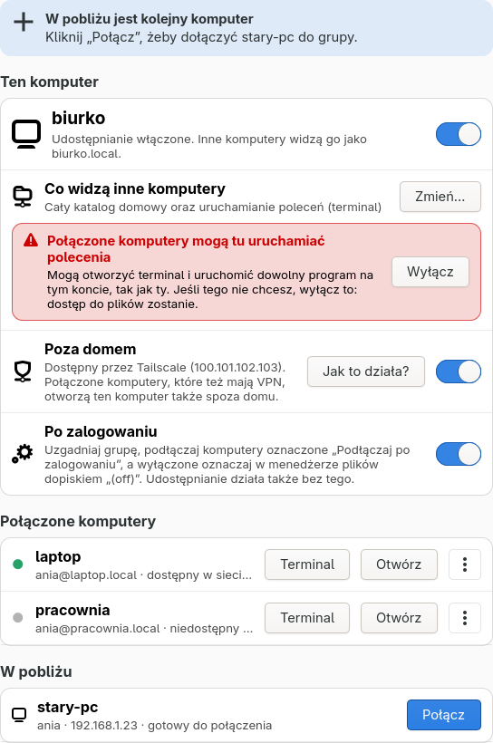
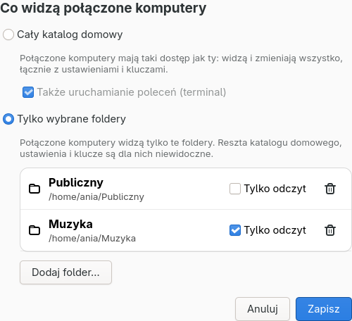
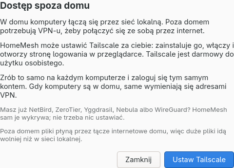

# HomeMesh

[English](README.md) · **Polski**

Katalogi domowe wszystkich twoich komputerów, prosto w menedżerze plików.
Połącz dwa komputery raz, sześciocyfrowym kodem, jak urządzenia Bluetooth, a
każdy pojawi się w panelu bocznym Nautilusa, Dolphina, Thunara, Nemo albo
Caja. Klikasz i przeglądasz, kopiujesz i edytujesz pliki na drugim komputerze.
W domu przez sieć lokalną, poza domem przez VPN, jeśli go masz.

Bez Samby, bez NFS, bez serwera do utrzymania: pod spodem działa zwykłe
SSH/SFTP, które ma każdy Linux.

<picture>
  <source media="(prefers-color-scheme: dark)" srcset="docs/screenshots/pl/overview-dark.png">
  
</picture>

## W skrócie

| | |
|---|---|
| **Trzy kliknięcia** | *Włącz* udostępnianie, otwórz HomeMesh na drugim komputerze, kliknij *Połącz* i sprawdź, czy oba ekrany pokazują ten sam kod. Pasek u góry okna zawsze podpowiada następny krok, a gdy coś jest nie tak, proponuje naprawę. |
| **Parowanie jak Bluetooth** | Komputery wymieniają klucze SSH i porównują sześciocyfrowy kod. Zgodne kody oznaczają, że nikt w sieci nie podmienił danych. Bez haseł, bez wpisywania adresów. |
| **Przedstawianie** | Nowy komputer wystarczy połączyć z dowolnym członkiem grupy, a pozna wszystkich; ci, których nie spotkał, dowiedzą się o nim przy najbliższym kontakcie. Usunięcie komputera rozchodzi się tak samo. |
| **Twój menedżer plików** | Połączone komputery są zakładkami w menedżerach GTK (GVfs) i w Dolphinie (KIO). Kliknięcie montuje; opcjonalnie montują się po zalogowaniu. Wyłączony komputer ma dopisek: *(off) laptop*. |
| **Wybierasz, co udostępniasz** | Cały katalog domowy albo tylko wybrane foldery, każdy do odczytu i zapisu albo tylko do odczytu. Wybrane foldery idą z piaskownicy: reszty katalogu domowego, kluczy i systemu po prostu tam nie ma. |
| **Terminal na drugim komputerze** | *Terminal* obok *Otwórz* loguje do tamtego komputera w twoim programie terminala, w domu albo przez VPN. Domyślnie włączony przy całym katalogu domowym, pod czerwonym ostrzeżeniem z przyciskiem *Wyłącz* w oknie. |
| **Poza domem** | Jedno kliknięcie ustawia Tailscale: HomeMesh go instaluje, uruchamia i otwiera stronę logowania, bez żadnych poleceń. Masz już NetBird, ZeroTier, Yggdrasil, Nebula albo WireGuard? Wykryje je sam. Połączenie idzie przez sieć lokalną, gdy się da, a w przeciwnym razie przez VPN; zakładki zostają te same. |
| **Radzi sobie z niestabilną siecią** | Gdy sieć lokalna gubi drogę między dwoma komputerami (na przykład mesh Wi-Fi, który z opóźnieniem zauważa, że laptop się przeniósł), połączenia idą najpierw przez VPN, dopóki nie będzie spokoju przez trzy dni: w domu mniej więcej tak samo szybko, a otwarte foldery zostają otwarte. Okno o tym mówi i podpowiada, [co pomaga](docs/local-network.pl.md). |
| **Lekki** | GTK 4 bez libadwaita, więc pasuje do każdego pulpitu. Bez demona w systemie: pliki podaje systemowy `sshd`, okno jest potrzebne tylko do znajdowania i łączenia komputerów, a jeden mały proces w twojej sesji oznacza wyłączone. Działa z systemd i bez niego. |
| **Także w terminalu** | Wszystko, co robi okno, zrobi też polecenie `homemesh`, więc dołączą również komputery bez ekranu. |

## Zrzuty ekranu

<table>
<tr>
<td width="50%" valign="top">

**Parowanie**: oba komputery pokazują ten sam kod.

<picture>
  <source media="(prefers-color-scheme: dark)" srcset="docs/screenshots/pl/pair-dark.png">
  
</picture>

**Co widzą inne komputery**: wszystko albo wybrane foldery.

<picture>
  <source media="(prefers-color-scheme: dark)" srcset="docs/screenshots/pl/share-dark.png">
  
</picture>

</td>
<td width="50%" valign="top">

**Poza domem**: Tailscale ustawiony jednym kliknięciem.

<picture>
  <source media="(prefers-color-scheme: dark)" srcset="docs/screenshots/pl/away-dark.png">
  
</picture>

</td>
</tr>
</table>

## Instalacja

Z AUR, najnowsze wydanie albo wersja rozwojowa:

    paru -S homemesh          # albo: yay -S homemesh
    paru -S homemesh-git

Z kopii repozytorium:

    packaging/arch/build-local.sh
    sudo pacman -U build/arch/homemesh-*.pkg.tar.zst

Wymaga `openssh`, `python-gobject`, `gtk4` i `polkit`. Opcjonalnie: `gvfs` dla
menedżerów plików GTK, `kio-extras` dla Dolphina, `bubblewrap` do udostępniania
tylko wybranych folderów, `avahi` i `nss-mdns` dla adresów `nazwa.local` w
systemach bez systemd-resolved. Gdy czegoś brakuje, HomeMesh pokazuje przycisk
*Zainstaluj brakujące pakiety* i instaluje je menedżerem pakietów twojej
dystrybucji (pacman, apt, dnf, zypper, xbps albo apk); w terminalu najpierw
pyta, albo `homemesh enable --install`.

## Jak zacząć

1. Otwórz **HomeMesh** i kliknij **Włącz**. Komputer raz zapyta o hasło
   administratora.
2. Zrób to samo na drugim komputerze w tej samej sieci. Pojawi się w sekcji
   *W pobliżu*.
3. Kliknij **Połącz**, sprawdź, czy oba ekrany pokazują ten sam kod, i
   potwierdź na obu.

Drugi komputer jest już w panelu bocznym menedżera plików. Trzeci komputer
wystarczy połączyć z którymkolwiek z dwóch.

## Poza domem

W domu komputery łączą się przez sieć lokalną. Poza domem potrzebny jest VPN,
żeby odnalazły się przez internet: dwa komputery za domowymi routerami nie
połączą się bez pośrednika z publicznym adresem, a istniejące VPN-y robią to
dobrze. HomeMesh nie ma własnego; sam wykrywa Tailscale, NetBird, ZeroTier,
Yggdrasil, Nebula i WireGuard.

Najprościej z Tailscale (darmowy do użytku domowego), a HomeMesh ustawia go
sam: w sekcji *Poza domem* włącz przełącznik, a potem kliknij **Ustaw
Tailscale**.
Po podaniu hasła administratora:
- instaluje Tailscale systemowym menedżerem pakietów (pacman, apt, dnf,
  zypper, xbps albo apk), a jeśli dystrybucja nie ma pakietu, oficjalną
  statyczną wersję z pkgs.tailscale.com sprawdzoną sumą sha256;
- uruchamia `tailscaled` przy starcie systemu z systemd, OpenRC, runit, s6
  albo dinit; gdy pakiet nie ma usługi dla danego systemu startowego (np. w
  Artix), zapisuje ją sam;
- robi cię operatorem Tailscale, więc logowanie i późniejsze zmiany nie
  wymagają hasła;
- otwiera stronę logowania w przeglądarce i po zalogowaniu kończy resztę.

Zrób to samo na każdym komputerze, tym samym kontem (w terminalu: `homemesh
away`). Gdy komputery są w domu, wymieniają się adresami VPN; wyłączony na
chwilę VPN nie kasuje adresu, a nowy adres sam dociera do pozostałych. Od tej
chwili każde połączenie najpierw sprawdza sieć lokalną (w domu około 40 ms; poza
domem sprawdzenie rezygnuje po mniej więcej sekundzie), a VPN-u używa tylko
wtedy, gdy drugiego komputera w niej nie ma. Poza domem pliki płyną przez łącze
internetowe domu, więc duże pliki idą wolniej niż w domu.

Tym samym przełącznikiem wyłączysz Tailscale na tym komputerze (`homemesh away
off`). Połączone komputery dotrą do niego wtedy tylko w sieci lokalnej, a jego
adres VPN od razu znika z jego karty, zamiast zostać na niej jak przy VPN-ie
wyłączonym na chwilę. Tailscale zostaje zainstalowany i zalogowany, więc
ponowne włączenie trwa sekundę i nie wymaga logowania. VPN, który prowadzisz
sam, zostaje włączony: wyłącz go tam, gdzie go ustawiono.

VPN pomaga także w domu, w którym [sieć lokalna się
zrywa](docs/local-network.pl.md): po drugim zerwaniu w ciągu trzech dni SSH
próbuje najpierw VPN-u.

## Co widzą inne komputery

- **Cały katalog domowy** (domyślnie): taki dostęp jak twoje konto, łącznie z
  ustawieniami i kluczami. Łącz tylko własne komputery.
  - **Także uruchamianie poleceń (terminal)**, domyślnie włączone: połączone
    komputery mogą tu otworzyć terminal (przycisk *Terminal* po ich stronie) i
    uruchomić dowolny program, tak jak ty. Główne okno mówi o tym na czerwono,
    z przyciskiem *Wyłącz* obok. Po wyłączeniu zostają same pliki: SFTP i
    synchronizacja grupy idą przez `homemesh gate`, wszystko inne jest
    odrzucane. To powstrzyma przypadkowe użycie, ale nie zdeterminowane, bo
    wystarczy zapis do `~/.bashrc` albo autostartu, żeby podrzucić polecenie;
    prawdziwą granicę dają wybrane foldery.
- **Tylko wybrane foldery**, każdy do odczytu i zapisu albo tylko do odczytu.
  Połączone komputery dostają wtedy wyłącznie SFTP: `sftp-server` działa w
  piaskownicy [bubblewrap](https://github.com/containers/bubblewrap), w której
  jest pusty katalog domowy z samymi wybranymi folderami. Nie ma powłoki,
  przekierowań portów, `~/.ssh` ani `/etc` poza jednowierszowym `passwd`.
  Zmiana kończy bieżące połączenia, więc działa od razu.

Przekierowania portów, agenta SSH i X11 są dla kluczy połączonych komputerów
wyłączone w każdym trybie (`restrict` w `authorized_keys`).

Przycisk *Terminal* uruchamia `ssh` z konfiguracją HomeMesh w
`xdg-terminal-exec`, jeśli jest zainstalowany, a inaczej w terminalu
ustawionym w Plasmie, w `$TERMINAL`, we własnym terminalu pulpitu albo w
jednym z popularnych (Ptyxis, Konsola GNOME, Konsole, xfce4-terminal, kitty,
foot, Alacritty, xterm…). Pokazuje się tylko przy komputerach, które na to
pozwalają; mówi o tym ich karta.

## W terminalu

    homemesh                 # okno (na pulpicie)
    homemesh status          # ten komputer i grupa
    homemesh enable          # włącz udostępnianie (pyta o hasło administratora)
    homemesh disable         # wyłącz je, przywracając poprzednie ustawienia
    homemesh pair            # wybierz komputer w pobliżu i połącz kodem
    homemesh pair --wait     # czekaj, aż inny komputer się połączy
    homemesh pair NAZWA|ADRES[:PORT]
    homemesh remove NAZWA    # usuń komputer z grupy
    homemesh sync            # uzgodnij grupę teraz
    homemesh share           # co widzą inne komputery
    homemesh share add ~/Publiczny [--readonly]
    homemesh share remove ~/Publiczny
    homemesh share home      # z powrotem cały katalog domowy
    homemesh share terminal on|off   # czy połączone komputery mogą tu uruchamiać polecenia
    homemesh autostart on|off
    homemesh rename NAZWA    # zmień nazwę tego komputera w sieci
    homemesh away            # ustaw Tailscale do dostępu spoza domu
    homemesh away off        # wyłącz Tailscale z powrotem
    homemesh reset           # opuść grupę i usuń ustawienia HomeMesh

## Jak to działa

**Włączenie udostępniania** uruchamia małego pomocnika z uprawnieniami roota
(`/usr/lib/homemesh/homemesh-helper`) przez polkit albo `sudo` w terminalu.
Pomocnik:
- ustawia `sshd` tak, żeby przyjmował logowanie tylko kluczem
  (`/etc/ssh/sshd_config.d/10-homemesh.conf`);
- uruchamia go przy starcie systemu, z systemd, OpenRC, runit, s6 albo dinit;
- otwiera zaporę (ufw albo firewalld) dla sieci lokalnej: 22/tcp, 41753/udp i
  41753–41762/tcp, a na interfejsach VPN samo SSH;
- włącza mDNS, jeśli `nazwa.local` jeszcze nie działa: w systemd-resolved
  (`/etc/systemd/resolved.conf.d/zz-homemesh-mdns.conf`; jako ostatni plik
  nadpisuje też wcześniejsze `MulticastDNS=no`), a jeśli się nie da, przez Avahi.

*Wyłącz* przywraca to, co było wcześniej. Ustawianie Tailscale idzie przez
tego samego pomocnika (patrz [Poza domem](#poza-domem)); wyłączenie
udostępniania zostawia Tailscale w spokoju.

**Znajdowanie komputerów**: gdy okno jest otwarte, HomeMesh ogłasza się w sieci
lokalnej rozgłoszeniem UDP. Działa to bez Avahi. Po zamknięciu okna
rozgłaszanie ustaje.

**Parowanie** wymienia klucze SSH przez TCP. Kod liczony jest ze wszystkiego,
co komputery wymieniły, a strona odpowiadająca najpierw zobowiązuje się do
swojej liczby losowej i ujawnia ją dopiero potem. To schemat porównania liczb
z Bluetooth: ktoś po drodze ma jedną szansę na milion, że kody wyjdą zgodne.

**Pliki**: każda strona zapisuje
- klucz drugiej w `~/.ssh/authorized_keys`, ważny tylko z adresów prywatnych i
  z adresów VPN tego komputera;
- jej klucz hosta w `~/.config/homemesh/known_hosts`, więc nigdy nie pada
  pytanie „czy ufasz temu komputerowi”;
- wpis w `~/.config/homemesh/ssh_config`, wczytywanym na początku
  `~/.ssh/config`;
- zakładki dla GTK (`~/.config/gtk-3.0/bookmarks`) i KDE
  (`~/.local/share/user-places.xbel`).

HomeMesh loguje się własnym kluczem (`~/.config/homemesh/id_ed25519`). Nie
rusza twoich kluczy ani żadnej linii, której sam nie dopisał.

**Grupa**: każdy komputer ma kartę (nazwa, użytkownik, katalog domowy, klucze,
adresy VPN). Przy każdym kontakcie (otwarte okno, logowanie, parowanie, nowy
adres VPN) członkowie wymieniają się tym, co wiedzą, przez `ssh … homemesh
sync-serve`. Wygrywa nowsza karta, a usunięcie zostawia datowany ślad, więc też
się rozchodzi. Adresy VPN zostają na karcie, gdy VPN nie działa (Tailscale łączy
się chwilę po zalogowaniu), dopóki nie milczy przez pół roku albo nie zostanie
wyłączony w HomeMesh.

**Po zalogowaniu**: krótkie zadanie z autostartu (do wyłączenia) uzgadnia grupę
i montuje komputery oznaczone *Podłączaj po zalogowaniu*, po czym się kończy.

**Wyłączone komputery**: to samo ustawienie uruchamia `homemesh watch`, jeden
proces zajmujący około 15 MB, który kończy się razem z sesją pulpitu. Dopisuje
*(off)* przed nazwą zakładki, gdzie żaden menedżer plików go nie utnie, i
zdejmuje, gdy komputer wróci; nazwy, które sam nadałeś zakładkom, zostają.
Włączony komputer jest pytany raz na minutę jednym pakietem UDP pod jego adres
(41753/udp); nic nie jest rozgłaszane i jego `sshd` nic nie zapisuje w
dzienniku. Wyłączony jest wyszukiwany co pięć minut, ale po włączeniu widać go
od razu, bo sam pyta pozostałe. Odpowiedź dostają tylko połączone komputery.
Komputery z HomeMesh starszym niż 0.5 albo takie, na których nikt się nie
zalogował, są zamiast tego sprawdzane połączeniem SSH co trzy minuty. Te same
pakiety pokazują, że sieć lokalna między dwoma komputerami [się
zrywa](docs/local-network.pl.md); komputery mówią o tym sobie nawzajem.

## Bezpieczeństwo

- Przy udostępnionym całym katalogu domowym połączone komputery ufają sobie w
  pełni: prawo zapisu w katalogu domowym jest tyle samo warte co uruchamianie
  tam programów, a z włączonym terminalem (domyślnie) uruchamiają je wprost.
  Łącz tylko własne komputery albo udostępniaj wybrane foldery.
- Klucze połączonych komputerów nie przekierowują portów, agenta SSH ani X11.
- Klucze działają tylko z adresów prywatnych i z adresów VPN danego komputera.
  `sshd` przestaje przyjmować hasła przez sieć.
- Parowanie i wykrywanie przyjmują tylko sieć lokalną (oraz adresy
  Tailscale/NetBird przy parowaniu po adresie z terminala).

## Stan

Wersja 0.8: młoda. Sprawdzona między komputerami z systemami opartymi na Archu,
z GNOME, KDE Plasma i LXQt. Oznaczanie wyłączonych komputerów sprawdzone z
pcmanfm-qt; obsługa Dolphina, instalowanie pakietów poza Archem i systemy bez
systemd (OpenRC, runit, s6, dinit) są napisane, ale jeszcze nie sprawdzone na
żywo. Zgłoszenia mile widziane.

## Odinstalowanie

    homemesh reset && homemesh disable
    sudo pacman -R homemesh      # albo homemesh-git

## Dla programistów

    make test                            # 158 testów, przed wydaniem; integracyjne uruchamiają prywatne instancje sshd
    packaging/arch/build-local.sh        # pakiet z drzewa roboczego
    homemesh --demo --screenshot x.png   # okno z wymyślonymi komputerami

Budowanie pakietu uruchamia tylko szybkie testy (`HOMEMESH_QUICK_TESTS=1`,
kilka sekund): bez instancji sshd, bez prawdziwego parowania, nic w sieci.

## Tłumaczenia

Interfejs mówi po angielsku i po polsku. Teksty w kodzie są angielskie, a
tłumaczenia idą przez gettext; polskie są w `po/pl.po`. Nowy język: `make pot`,
skopiuj `po/homemesh.pot` do `po/<język>.po`, przetłumacz (pola `{…}` zostają),
potem `make mo` i `LANGUAGE=<język> bin/homemesh`. `make test` sprawdza, czy
każdy tekst ma tłumaczenie z tymi samymi polami.

## Jeśli piszesz o HomeMesh

Gotowe opisy po angielsku i po polsku, od jednej linijki do pełnej listy
funkcji, są w [docs/descriptions.md](docs/descriptions.md); zrzuty ekranu w
[docs/screenshots](docs/screenshots).

## Licencja

MIT
